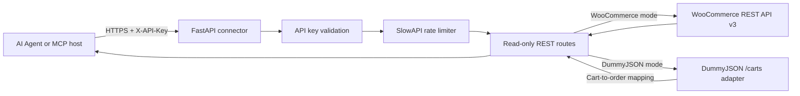

# WooCommerce Read-only Connector

> **Razorpay Forward-Deployed Engineer (Agent Studio) assignment**

A secure, read-only HTTP service that gives an AI Agent controlled access to WooCommerce order and product data. The connector uses FastAPI, validates an application API key, limits request rates, and communicates with the WooCommerce REST API v3. A DummyJSON carts adapter is available for development and demonstrations without a WooCommerce store.

## 1. Project Overview

The service exposes a small, bounded set of read-only endpoints for retrieving and searching store data. It does not create, update, or delete WooCommerce resources. The API key protects connector endpoints; separate WooCommerce read-only credentials authenticate the upstream store API.

**Technology stack:** Python, FastAPI, Uvicorn, SlowAPI, and Pydantic. The current upstream HTTP clients use `requests`; although HTTPX was listed in the assignment brief, it is not used by the implementation or required by the current dependency file.

## 2. Architecture



The WooCommerce client is implemented in `woocommerce.py`. FastAPI routes, configuration, authentication, logging, and the DummyJSON adapter are implemented in `main.py`. `mcp_tools.json` describes the agent-facing tools and their HTTP mappings.

## 3. Features

- API key authentication using the `X-API-Key` header.
- Read-only access to order and product collections.
- List orders, retrieve an order by ID, and search orders.
- List and search products.
- Configurable per-client-IP rate limiting with SlowAPI.
- OpenAPI schema and interactive Swagger UI.
- Liveness health check and an authenticated, secret-free configuration diagnostic.
- DummyJSON carts adapter for local/test use without a WooCommerce store.
- Pagination metadata on collection responses.
- Upstream error reporting and request logging.

**Product lookup by ID:** this is a desired connector capability, but there is no `GET /products/{product_id}` route in the current implementation. See [Limitations](#15-limitations).

## 4. API Endpoints

All endpoints are `GET` requests. Except for `/health`, the endpoints require `X-API-Key` authentication.

| Method | Endpoint | Description |
| --- | --- | --- |
| `GET` | `/health` | Unauthenticated liveness check. |
| `GET` | `/debug/config` | Authenticated diagnostic state; does not return credentials. |
| `GET` | `/orders` | List a page of orders. Supports `page`, `per_page`, `status`, `customer`, `after`, `before`, `order`, and `orderby` in WooCommerce mode. |
| `GET` | `/orders/{order_id}` | Get an order by numeric ID. |
| `GET` | `/orders/search?q=term` | Search orders. Supports pagination. |
| `GET` | `/products` | List a page of products. Supports pagination, category, tag, stock, and ordering filters. |
| `GET` | `/products/search?q=term` | Search products. Supports pagination. |

Collection parameters: `page` defaults to `1`; `per_page` defaults to `100` and is capped at `100`. Collection responses use this envelope:

```json
{
  "data": [],
  "pagination": {
    "page": 1,
    "per_page": 100,
    "total": 0,
    "total_pages": 0
  }
}
```

WooCommerce totals are read from its pagination headers. The DummyJSON adapter derives totals from the carts response and maps the cart fields to a subset of the WooCommerce order schema.

## 5. Installation

Requirements: Python 3.10 or newer and pip. For production WooCommerce mode, the store must have its REST API enabled and a key with **Read** permissions.

Create a virtual environment and install the project dependencies:

```powershell
python -m venv .venv
.\.venv\Scripts\Activate.ps1
pip install -r requirements.txt
```

On macOS/Linux, activate with `source .venv/bin/activate` instead. Keep dependency versions reviewed and pinned for reproducible deployments.

## 6. Environment Variables

Create a `.env` file in the project root. Do not commit real credentials.

```dotenv
API_KEY=replace-with-a-long-random-secret
WOOCOMMERCE_URL=https://your-store.example
WOOCOMMERCE_CONSUMER_KEY=ck_read_only_key
WOOCOMMERCE_CONSUMER_SECRET=cs_read_only_secret
WOOCOMMERCE_TIMEOUT_SECONDS=20
RATE_LIMIT=60/minute
LOG_LEVEL=INFO
```

| Variable | Required | Default | Description |
| --- | --- | --- | --- |
| `API_KEY` | Yes | — | Secret expected in `X-API-Key`. Use a high-entropy value. |
| `WOOCOMMERCE_URL` | Yes | — | Store origin, e.g. `https://shop.example`; do not append `/wp-json/wc/v3`. |
| `WOOCOMMERCE_CONSUMER_KEY` | Yes | — | WooCommerce REST API key with Read permission. Required by current configuration even in DummyJSON mode; dummy values are not sent to DummyJSON. |
| `WOOCOMMERCE_CONSUMER_SECRET` | Yes | — | Matching read-only WooCommerce secret; required by current configuration even in DummyJSON mode. |
| `WOOCOMMERCE_TIMEOUT_SECONDS` | No | `20` | Upstream request timeout in seconds. |
| `RATE_LIMIT` | No | `60/minute` | SlowAPI limit applied by client IP. |
| `LOG_LEVEL` | No | `INFO` | Python log level, such as `DEBUG`, `INFO`, or `WARNING`. |

For DummyJSON testing, set `WOOCOMMERCE_URL=https://dummyjson.com`. The consumer key and secret variables must still be present to pass configuration validation, but the adapter does not send them upstream.

## 7. Running Locally

Start the API from the repository root:

```powershell
uvicorn main:app --host 127.0.0.1 --port 8000 --reload
```

For a non-development run, omit `--reload`. Use HTTPS through a trusted reverse proxy or load balancer before exposing the service beyond localhost.

## 8. Authentication

Send the configured API key in the `X-API-Key` header for every business and diagnostic endpoint except `/health`:

```http
X-API-Key: <your API_KEY value>
```

The connector compares the key using a constant-time comparison and returns `401 Unauthorized` if it is missing or invalid. The API key is distinct from the WooCommerce consumer key and secret. Never include any of these credentials in URLs, tool arguments, source control, or logs.

## 9. Testing with Swagger UI

1. Start the service and open `http://127.0.0.1:8000/docs`.
2. Expand a route and select **Try it out**.
3. For authenticated routes, provide the `X-API-Key` header when prompted by the API-key security control, or use an authorized HTTP client.
4. Execute the request and inspect the JSON response and status code.

The raw OpenAPI schema is available at `/openapi.json`. The liveness route `/health` does not require authentication. `/debug/config` does require the application API key.

## 10. Rate Limiting

SlowAPI applies the configured `RATE_LIMIT` per client IP; the default is `60/minute`. Exceeding the configured limit returns `429 Too Many Requests`. The current default limiter uses in-memory storage, so counters are not shared across worker processes or service replicas. Use a shared storage backend for multi-instance deployments and configure trusted proxy IP handling carefully.

## 11. DummyJSON Test Mode

When the hostname in `WOOCOMMERCE_URL` is `dummyjson.com` or `www.dummyjson.com`, the application enables its carts adapter. It requests `https://dummyjson.com/carts` for order lists/searches and `/carts/{id}` for order lookup. The adapter maps cart data to a limited, WooCommerce-like order representation, including line items, totals, currency, status, and customer ID.

DummyJSON is a public demo API, not a WooCommerce store. Values such as order status, currency, billing/shipping details, and dates are synthetic/defaulted by the adapter. Product endpoints are not supported in this mode and return `501 Not Implemented`. The adapter is intended for demonstration and local integration checks, not as production order data.

The authenticated `GET /debug/config` endpoint returns only `store_url`, `is_dummyjson`, `woocommerce_client_exists`, and `dummyjson_session_exists`. It never returns API keys or WooCommerce credentials.

## 12. MCP Tool Specification

`mcp_tools.json` contains JSON input schemas and HTTP endpoint mappings for read-only order and product tools. It is a tool manifest, **not** a standalone MCP transport/server implementation. An MCP host or adapter must invoke the mapped HTTP routes and inject `X-API-Key` from secure host-side configuration. Do not add secrets to tool inputs or the manifest.

The current manifest does not define a product-by-ID tool because the corresponding HTTP route is not currently implemented.

## 13. Security Considerations

- Use a long, unique `API_KEY`; store it in a secret manager in production.
- Create WooCommerce API credentials with **Read** permission only.
- Use TLS for all non-local traffic and restrict access to the API service.
- Do not commit `.env` or place secrets in request URLs, MCP manifests, or logs.
- Restrict log access. DummyJSON diagnostic logging includes the final URL, status, and up to the first 1,000 characters of the upstream response body; avoid using real personal data in test fixtures.
- Do not trust forwarded client-IP headers unless they are set by a trusted proxy configured by the deployment.
- Keep FastAPI, dependencies, WordPress, and WooCommerce patched; rotate credentials if they are exposed.
- The sample API key shown in any local `.env` file is for development only. Replace it before any shared or production deployment.

## 14. Assumptions

- The WooCommerce store uses the REST API v3 at `/wp-json/wc/v3`.
- `WOOCOMMERCE_URL` is the store origin, not the REST API endpoint URL.
- WooCommerce credentials are valid and limited to read access.
- A collection is paginated; callers follow `pagination.total_pages` rather than expecting an unbounded response.
- DummyJSON carts are a test stand-in for orders and do not represent WooCommerce semantics exactly.
- The MCP manifest is consumed by a separate MCP-capable host or adapter.

## 15. Limitations

- `GET /products/{product_id}` is not implemented in the current service.
- DummyJSON mode supports carts/orders only; product list/search routes return 501.
- DummyJSON order fields are approximations; its cart data does not provide real WooCommerce billing, shipping, status, currency, or date fields.
- The current rate-limit backend is in-memory and is not distributed across worker processes.
- The current WooCommerce HTTP client in `woocommerce.py` uses `requests`; HTTPX is not currently the upstream transport implementation.
- Search behavior and available filters depend on WooCommerce and the adapter mode.
- This service provides API-key authentication, but does not implement user accounts, OAuth, or per-user authorization.

## 16. Future Improvements

- Add a product-by-ID endpoint and matching MCP tool.
- Use HTTPX with a shared asynchronous client if asynchronous upstream I/O is required.
- Add automated unit, integration, and contract tests for WooCommerce and DummyJSON responses.
- Support shared Redis-backed rate-limit storage and explicit trusted-proxy configuration.
- Define response models and richer pagination/filter validation.
- Add metrics, tracing, readiness checks, and structured log redaction policies.
- Make DummyJSON diagnostics configurable so upstream body logging can be disabled outside development.
- Package and run the service with a production process manager/container deployment.

## 17. Folder Structure

```text
woocommerce-agent-connector/
├── main.py          # FastAPI app, routes, auth, rate limit, DummyJSON adapter
├── woocommerce.py   # Read-only WooCommerce REST API client
├── mcp_tools.json   # MCP-style tool manifest and endpoint mappings
├── requirements.txt # Python dependencies
├── README.md        # Project documentation
└── .env             # Local secrets; do not commit
```

## 18. Example API Requests

Health check:

```powershell
curl.exe http://127.0.0.1:8000/health
```

List orders:

```powershell
curl.exe -H "X-API-Key: <your-api-key>" "http://127.0.0.1:8000/orders?page=1&per_page=25"
```

Get an order by ID:

```powershell
curl.exe -H "X-API-Key: <your-api-key>" http://127.0.0.1:8000/orders/123
```

Search orders and products:

```powershell
curl.exe -G -H "X-API-Key: <your-api-key>" --data-urlencode "q=coffee" http://127.0.0.1:8000/orders/search
curl.exe -G -H "X-API-Key: <your-api-key>" --data-urlencode "q=coffee" http://127.0.0.1:8000/products/search
```

List products:

```powershell
curl.exe -H "X-API-Key: <your-api-key>" "http://127.0.0.1:8000/products?page=1&per_page=25"
```

Inspect the non-secret runtime configuration:

```powershell
curl.exe -H "X-API-Key: <your-api-key>" http://127.0.0.1:8000/debug/config
```

## 19. Assignment Deliverables

- `main.py` — FastAPI application, authentication, routes, rate limiting, logging, and DummyJSON carts adapter.
- `woocommerce.py` — read-only WooCommerce REST API v3 client and upstream error handling.
- `mcp_tools.json` — MCP-style tool definitions with input schemas and HTTP mappings.
- `requirements.txt` — runtime dependencies.
- `README.md` — setup, API usage, architecture, security guidance, and known limitations.

## 20. License

No license has been specified for this repository. Unless a license file is added, all rights remain with the copyright holder and reuse or redistribution may require permission. Add a `LICENSE` file before distributing the project under an open-source license.
